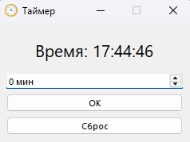

# ⏻ Таймер выключения ПК (Shutdown Timer)
Простое и удобное десктопное приложение на Python с графическим интерфейсом PyQt5, которое позволяет запланировать автоматическое выключение компьютера через заданное количество минут. Программа поддерживает **Windows** и **Linux**, умеет сохранять состояние между перезапусками и управляется горячими клавишами.

## 📋 О проекте
Часто бывает нужно, чтобы компьютер выключился сам — например, после завершения загрузки фильма или скачивания файлов. Это приложение решает задачу без командной строки и сложных настроек: вы вводите количество минут, нажимаете «ОК», и система выключается в назначенное время.

**Ключевая особенность:** программа не просто запускает `shutdown`, а хранит метку времени в файле состояния. Если вы закроете приложение и откроете его снова — таймер продолжит тикать с обновлением времени.

## Приложения

## ✨ Основные возможности
* ⏱️ **Планирование выключения** — таймер обратного отсчёта на заданное количество минут.
* ⚠️ **Мгновенное выключение** — если ввести 0 минут, программа запросит подтверждение и выключит ПК через 1 секунду.
* ❌ **Отмена выключения** — кнопка «Сброс» или клавиша `Esc` отменяет запланированное завершение работы.
* 💾 **Сохранение состояния** — метка времени хранится в `~/.shutdown_timer.state`, поэтому таймер не сбрасывается при перезапуске приложения.
* ⌨️ **Горячие клавиши** — `Enter` запускает таймер, `Esc` отменяет его.
* 🖥️ **Кроссплатформенность** — поддержка Windows (`shutdown /s /t`) и Linux (`shutdown -h +N`).
* 🕒 **Часы реального времени** — когда таймер неактивен, в окне показывается текущее время.
* 📝 **Логирование** — все важные события и ошибки пишутся в лог через стандартный модуль `logging`.

## 🛠️ Стек технологий
* **Язык:** Python 3.8+
* **GUI:** PyQt5
* **Системные вызовы:** `subprocess`, `sys.platform`
* **Хранение состояния:** `pathlib.Path`, домашняя директория пользователя
* **Логирование:** стандартный `logging`

## 🚀 Установка и запуск
* pip install PyQt5
* python main.py